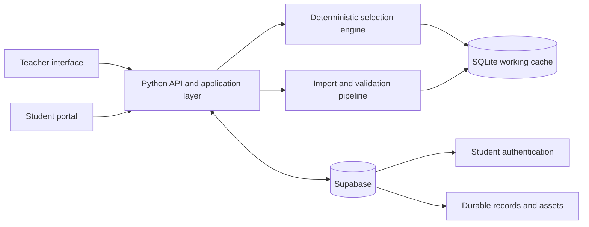

# SAT Practice Test Builder

An AI-assisted assessment platform that helps educators turn a structured SAT
question bank into targeted, reproducible practice tests while keeping teacher
tools, student experiences, and answer data appropriately separated.

> **Portfolio case study:** The production source code, student data, and
> licensed question-bank content are maintained privately. This repository
> documents the product, architecture, engineering decisions, and validation
> strategy without publishing the implementation.

## At a glance

| Area | Details |
| --- | --- |
| Application | Teacher test builder and student practice portal |
| Backend | Python application and HTTP API |
| Frontend | HTML, CSS, and JavaScript |
| Data | Supabase for durable cloud storage; SQLite for local workflows |
| Deployment | Vercel serverless deployment |
| Quality | 73 automated Python test functions plus question-bank audits |
| AI-assisted development | OpenAI Codex and GitHub Copilot in Visual Studio Code |

## The problem

Preparing individualized SAT practice is time-consuming. Teachers need to
select an exact mix of domains, skills, and difficulty levels; avoid repeating
questions already assigned to a student; preserve answer security; and turn
raw testing data into useful follow-up practice.

This project brings those activities into one workflow. A teacher can describe
the desired test in natural language, review the interpreted blueprint, and
generate a deterministic test that follows the approved constraints exactly.

## Product capabilities

### Teacher workflow

- Build a test from a natural-language request.
- Review and edit the interpreted blueprint before generation.
- Request exact question counts by domain, skill, and difficulty.
- Generate randomized drafts without duplicate questions.
- Reuse a seed to reproduce a specific test.
- Receive explicit shortage feedback instead of unrelated substitutions.
- Assign tests separately from drafting them.
- View student performance and domain-level trends.
- Import question batches and review validation exceptions.

### Student workflow

- Sign in to a student-specific portal.
- View pending and completed assignments.
- Take a student-safe version that never includes the answer key.
- Review recent scores, accuracy, and domain performance.

## Architecture



The language model interprets the teacher's request into an editable blueprint.
It does **not** make the final allocation decision. A deterministic selector
validates counts, eligibility, prior assignment history, and duplicate
prevention before producing a test.

## Representative private code map

The following files are documented to show responsibility boundaries; their
contents are intentionally not included here.

```text
sat_app/core.py             Question ingestion, selection, and persistence
sat_app/importers.py        PDF extraction and assessment-result imports
sat_app/audit_bank.py       Repeatable question and visual integrity checks
sat_app/supabase_backend.py Cloud synchronization and durable storage
sat_app/server.py           HTTP routes, authorization, and application server
static/                     Teacher and student browser experiences
supabase/                   Database schema and workflow migrations
tests/                      Allocation, privacy, import, and route tests
api/index.py                Serverless deployment entry point
```

## Selected engineering decisions

### Deterministic enforcement after AI interpretation

Natural language is useful for translating teacher intent, but exact test
composition should not depend on probabilistic output. The system converts the
request into an editable plan and then uses deterministic application logic to
enforce the approved requirements.

### Explicit failure instead of silent substitution

If the question bank cannot satisfy a requested allocation, the application
reports the precise shortage. It does not quietly insert questions from a
different skill or difficulty level.

### Separate teacher and student boundaries

The student experience is intentionally separate from teacher tools and never
receives answer-key data. Hosted deployments add authentication and server-side
authorization for student-scoped records.

### Reproducibility

Seeded selection makes a generated test reproducible. This supports debugging,
review, and consistent regeneration while retaining randomized selection.

### Private data by design

Imported student information, generated-test records, credentials, and licensed
question content are excluded from this public portfolio. Demonstrations use
synthetic data only.

## Verification strategy

The private project currently includes **73 Python test functions** covering
areas such as:

- exact allocation and shortage behavior;
- repeatability and duplicate prevention;
- teacher/student data boundaries;
- Supabase synchronization and migrations;
- question and workbook imports;
- server routes and authentication workflows; and
- whole-bank content and visual integrity audits.

The audit pipeline checks active question records for required answers,
malformed metadata, unresolved review exceptions, and missing or invalid visual
assets.

## Development workflow and responsible AI use

I used **OpenAI Codex** and **GitHub Copilot in Visual Studio Code** as
AI-assisted engineering tools during development. They helped accelerate tasks
such as implementation planning, code generation, debugging, refactoring,
documentation, and test creation.

I remained responsible for the product requirements, architecture, data model,
privacy boundaries, acceptance criteria, and final technical decisions. AI
suggestions were reviewed in context and validated through automated tests,
audits, and manual workflow checks before being accepted.

## What this project demonstrates

- Translating an ambiguous user request into a reviewable structured workflow
- Combining AI-assisted interpretation with deterministic business rules
- Designing separate experiences for users with different permissions
- Building import, validation, persistence, and reporting pipelines
- Testing privacy-sensitive and data-intensive application behavior
- Deploying a Python-backed web application with managed cloud storage

## Demonstration and source review

The implementation is private to protect student information, credentials,
licensed educational content, and project IP. I can provide a guided product
demonstration and technical walkthrough during an interview.

---

Built as an independent portfolio project with an AI-assisted development
workflow.
