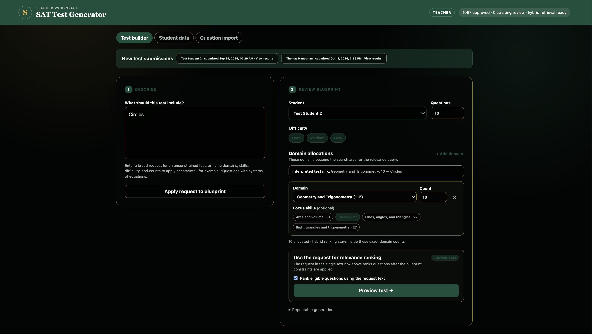
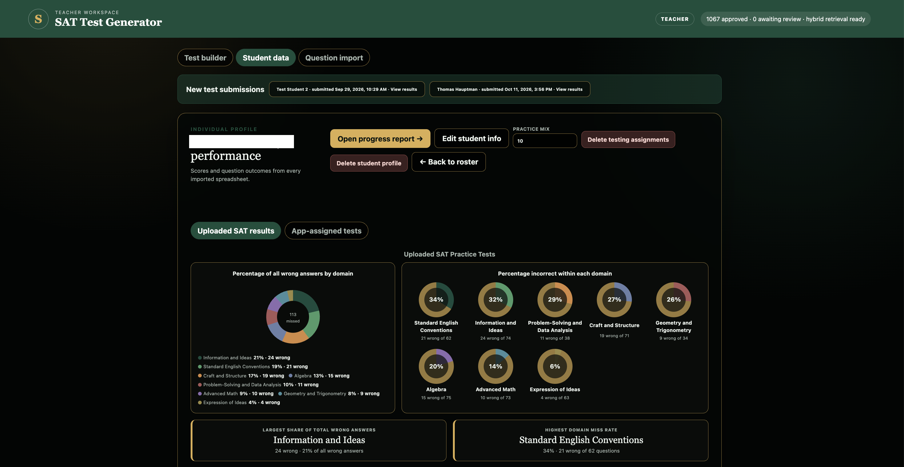
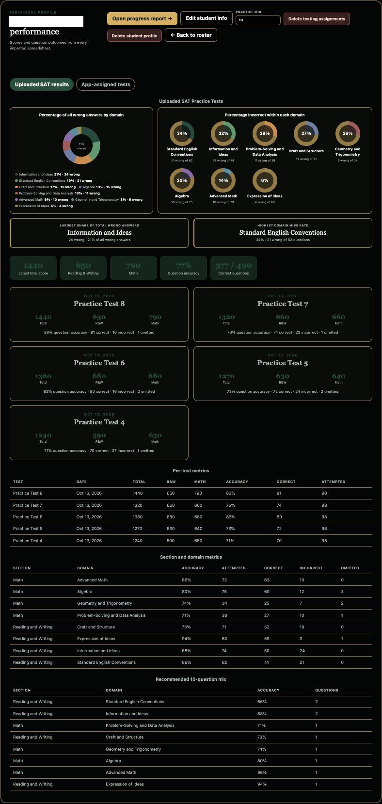
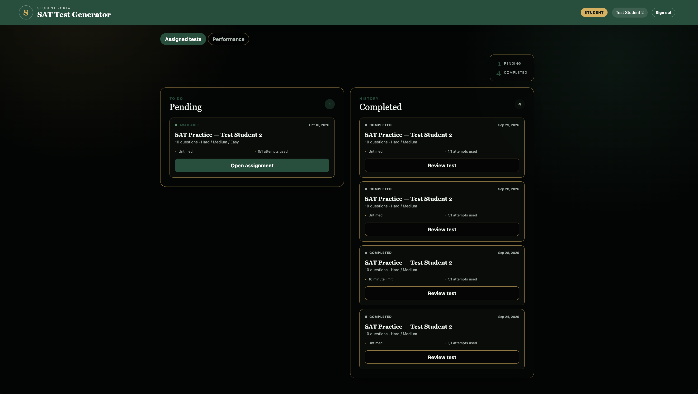
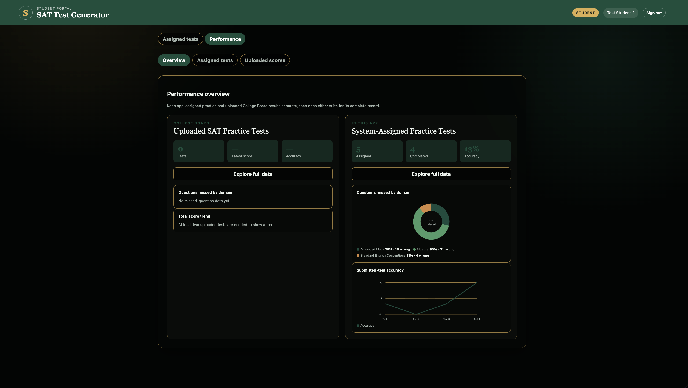

# SAT Practice Test Builder

A private SAT practice platform that helps a teacher turn a question bank and student results into targeted, reproducible practice tests. A teacher reviews the test plan and assigns a generated draft; students complete their own assignments in a separate portal.

This public repository is a **portfolio case study**, not the application source. The implementation, student records, credentials, and licensed question content remain private. A guided demonstration and technical walkthrough can be provided during an interview.

## What it does

- **Build targeted practice:** Interpret a teacher's natural-language request into an editable blueprint with question counts, domains, skills, and difficulty. Generate a seeded draft, review it, and assign it separately.
- **Find relevant questions:** Apply eligibility constraints first, then optionally rank candidates by lexical relevance, SAT concepts, metadata, and semantic embeddings. An optional language model can explain retrieved matches; it does not decide the test's allocations.
- **Avoid repeats:** Assigned questions are recorded and excluded from later assignments for the same student. The generator reports shortages rather than silently substituting unrelated questions.
- **Import and review content:** Import question-bank PDFs, render question visuals, and surface validation exceptions for teacher review. A bank audit checks records and visual assets.
- **Use student results:** Import Bluebook spreadsheets and view student scores, outcomes, test history, and domain performance. Students can view their own assignments and performance and submit answers.

## Product tour

These screenshots show the teacher and student workflows in the SAT Practice Test Builder.

### Teacher: create a test

A teacher enters a topic, selects a student, and reviews the interpreted blueprint. Domain counts, focus skills, difficulty, and relevance ranking help shape a targeted practice draft before assignment.

### Teacher: identify areas for practice

The student profile summarizes imported results by domain. A teacher can compare the distribution of missed questions with each domain's miss rate to decide where to focus next.

The detailed view adds scores, individual test results, domain metrics, and a recommended question mix. It helps a teacher review performance over time and plan follow-up practice.

### Teacher: import and review questions

Teachers can upload a question-bank PDF as a named batch, run validation, and review exceptions or an audit sample. Rendered question images preserve visual material such as graphs and formulas.

### Student: open and review assignments

The student sees pending and completed practice tests, opens an available assignment, and can revisit completed tests. Each card shows details such as question count, timing, and attempts.

### Student: track performance

The overview separates uploaded SAT results from tests assigned in the app. Students can inspect summary metrics, missed-question domains, and accuracy trends for each source.

The assigned-test detail breaks results down by test, domain, and skill, with a skill-progress table and suggested focus areas. Students can use it to see patterns and prioritize practice.

## How the system fits together

The diagram is a conceptual view of the application. The browser interfaces communicate through the Python HTTP API; the API coordinates the application modules. In a local run, SQLite stores working data. When configured for hosted use, Supabase is the durable store and the application hydrates a working SQLite cache and synchronizes changes. Optional embedding and summary services enrich retrieval, but the core ranking path can run without them.

### From request to practice test

1. The teacher describes a test and reviews or edits the parsed blueprint.
2. The application filters the question bank by the approved constraints and, for a student, prior assignments. Optional retrieval ranks eligible candidates using BM25, normalized terms, concept and metadata signals, and embeddings when configured.
3. Seeded selection assembles the draft and enforces the requested allocations and duplicate prevention. If the bank cannot meet the constraints, the teacher receives a shortage message.
4. The teacher reviews the draft and explicitly assigns it. The student portal serves a student-safe test; submitted responses feed completion and reporting workflows.

See the [engineering case study](docs/ENGINEERING_CASE_STUDY.md) for the design decisions, data flow, and limitations.

## Technology

| Area | Implementation |
| --- | --- |
| Interface | HTML, CSS, and JavaScript teacher and student interfaces |
| Application | Python HTTP API, selection engine, importers, and retrieval module |
| Data | SQLite locally; Supabase for configured hosted persistence and student authentication |
| Retrieval | BM25 and metadata/concept signals, with optional embeddings and grounded summaries |
| Deployment | Vercel Python Function configuration for a private hosted deployment |
| Verification | Python and frontend tests, plus a question-bank audit |

The private application has an automated Python test suite covering selection, imports, routes, retrieval, and persistence. On the reviewed local snapshot, `unittest` ran **102 tests successfully**. The public showcase does not include the private test data or application code.

## Engineering focus

The central design choice is to keep the teacher's approved constraints authoritative. Retrieval helps order an eligible pool; deterministic application logic handles selection, counts, exclusions, and shortages. This makes the result reviewable and reproducible without depending on a model to obey allocation rules.

OpenAI Codex and GitHub Copilot in Visual Studio Code assisted development. Product requirements, architectural choices, privacy boundaries, and acceptance decisions remained human-owned, with changes checked against the implementation and tests.
