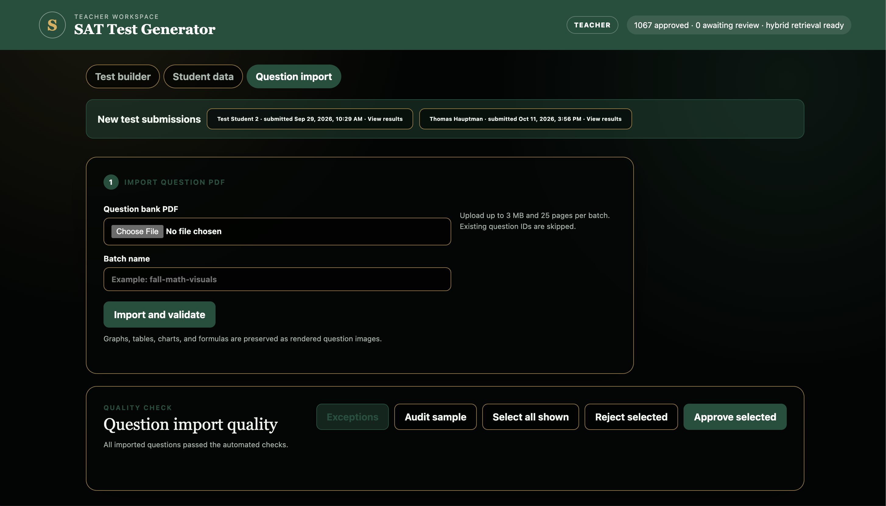
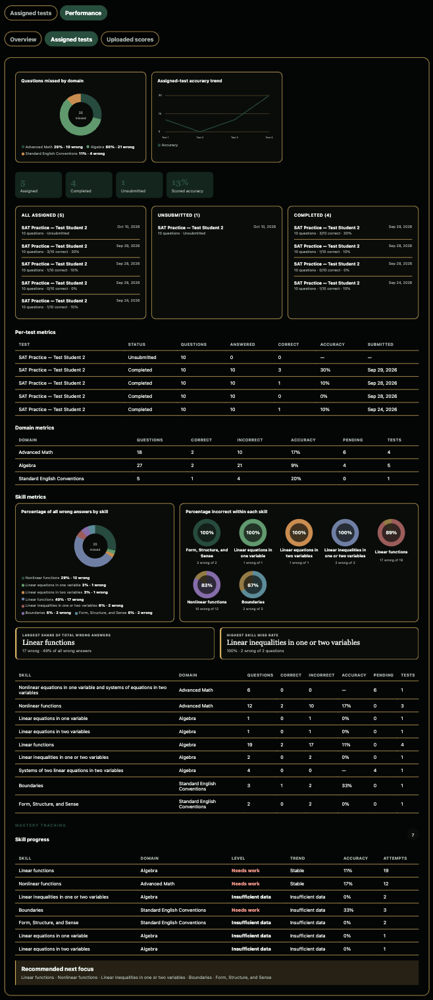

# Product tour

These screenshots show the teacher and student workflows in the SAT Practice Test Builder.

## Teacher: create a test

A teacher enters a topic, selects a student, and reviews the interpreted blueprint. Domain counts, focus skills, difficulty, and relevance ranking help shape a targeted practice draft before assignment.

## Teacher: identify areas for practice

The student profile summarizes imported results by domain. A teacher can compare the distribution of missed questions with each domain's miss rate to decide where to focus next.

The detailed view adds scores, individual test results, domain metrics, and a recommended question mix. It helps a teacher review performance over time and plan follow-up practice.

## Teacher: import and review questions

Teachers can upload a question-bank PDF as a named batch, run validation, and review exceptions or an audit sample. Rendered question images preserve visual material such as graphs and formulas.

## Student: open and review assignments

The student sees pending and completed practice tests, opens an available assignment, and can revisit completed tests. Each card shows details such as question count, timing, and attempts.

## Student: track performance

The overview separates uploaded SAT results from tests assigned in the app. Students can inspect summary metrics, missed-question domains, and accuracy trends for each source.

The assigned-test detail breaks results down by test, domain, and skill, with a skill-progress table and suggested focus areas. Students can use it to see patterns and prioritize practice.
